# OpenOWON

Open firmware for OWON bench multimeters. A complete replacement for the
stock firmware: everything stock does, faster and with the features owners
have asked for. It installs over the meter's USB serial port, with no need
to open the case.

## Compatibility

| Meter | Hardware | Status |
| --- | --- | --- |
| OWON XDM1241 | digital board `XDM1041_dig_v1.7`, GD32F303, stock V4.x | **Supported**: developed and tested on this meter |
| OWON XDM1041 | the same digital board, mains-powered | Expected to work; not yet tested |
| XDM1041 / XDM1241, older boards | STM32F103, stock v2.x | Not supported yet (different pin map) |
| OWON XDM2041 | same front-end chip, different board | Not supported yet |

I'll add support for more hardware as I get access to it.

**Status:** every stock function runs on the meter's real front end, on
its own factory calibration: DC and AC volts, DC and AC current on both
jacks, resistance, continuity, diode, capacitance to 50 mF, frequency and
temperature. Each was checked against reference parts
([test plan](docs/test-plan.md)). Still open: soft power-off and the
off-state battery drain ([backlog](docs/backlog.md)).

> **Installing replaces OWON's firmware, very likely for good.** OWON
> doesn't publish its firmware for current hardware, and the chip is
> readout-protected, so stock can't be backed up first. Your factory
> calibration is kept. Read [Installing](docs/install.md) before you start.

<p align="center">
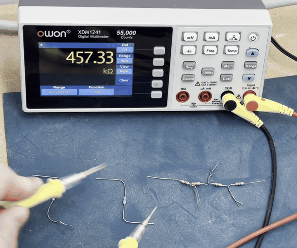
</p>
<p align="center"><sub>On the meter, real time: leads lifted (overload), then a 1.5 kΩ resistor.</sub></p>

<p align="center">
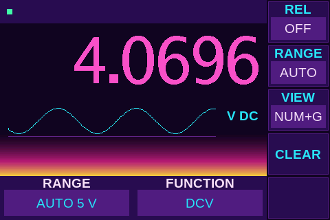
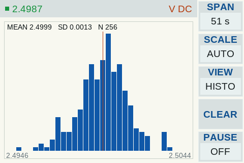
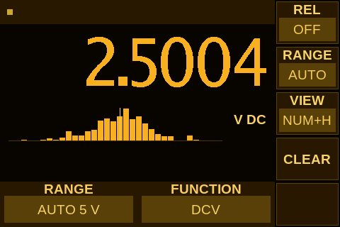
</p>
<p align="center">
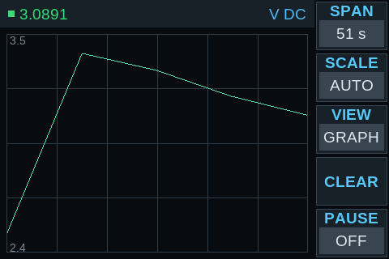
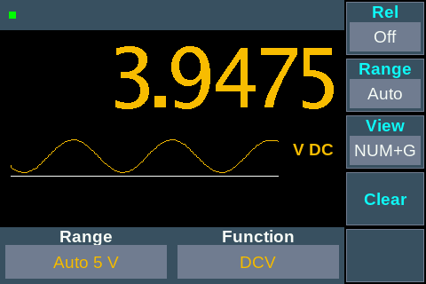
</p>
<p align="center"><sub>Live trend and histogram, under the reading or full screen, in five themes.
These screens are the real firmware, running in the
<a href="docs/app.md">host simulator</a>.</sub></p>

## Stock vs. OpenOWON

| Feature | Stock | OpenOWON | Details |
| --- | --- | --- | --- |
| **Autoranging** | slow | **fast** | • jumps straight to the right range instead of one at a time<br>• hunts with fast conversions, then measures at full resolution<br>• leads lifted: ~0.3 s (stock 7–9 s); touched: 0.3–0.8 s (stock ~3.5 s)<br>• DC 0 → 25 V: 0.4–0.6 s |
| **Reading rate** | 1–3 /s | **4–16 /s** | • SPEED low / mid / high: ~4 / 8 / 16 readings a second<br>• even low is faster than stock's fastest |
| **Display response** | ~4 s to settle | **instant** | • a big change shows within one conversion<br>• noise near a range boundary doesn't make the range flap |
| **Settings at power-on** | partly forgotten | **all kept** | • function, speed and every menu setting<br>• stored power-cut-safe: a cut mid-save keeps the old or the new value |
| **Data log** | 1,000 points | **10,668 points** | • survives power cuts<br>• fast mode: every 15 ms (DC V, DC I, ohms), like stock's internal recorder<br>• rolling (overwrite the oldest) or stop when full<br>• browse on screen with a cursor<br>• download with `LOG:DATA?`, or in stock's own format (`INT:RECord?`)<br>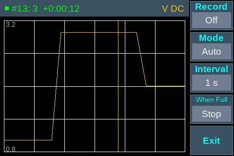 |
| **Trend graph** | ✗ | ✓ | • 51 s, 4 min or 26 min<br>• auto or full-scale axis, pause<br> |
| **Histogram** | ✗ | ✓ | • the spread of readings, from the graph screen<br>• mean and standard deviation<br>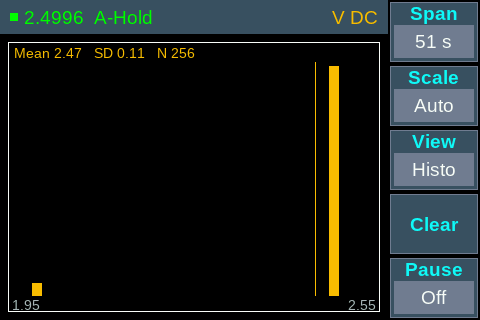 |
| **Mini graph under the reading** | ✗ | ✓ | • the trend, or its histogram, drawn under the big digits<br>• the number stays big; the history is visible at the same time<br>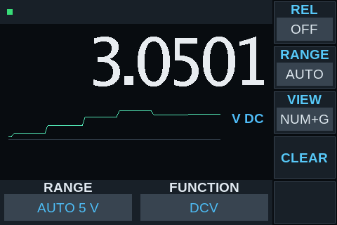 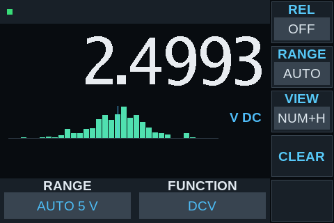 |
| **Bar graph** | ✗ | ✓ | • under the reading, zero in the middle for DC and REL<br>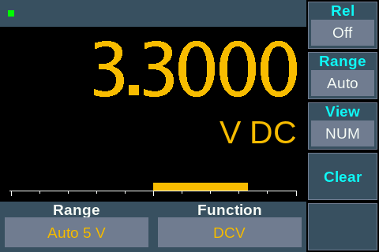 |
| **Clock and timestamps** | ✗ | ✓ | • a real-time clock on its backup cell, set over SCPI<br>• each recording keeps its start time; the browse cursor shows clock time |
| **Statistics with REL** | ✗ | ✓ | • REL works alongside min / max / average and dB/dBm<br>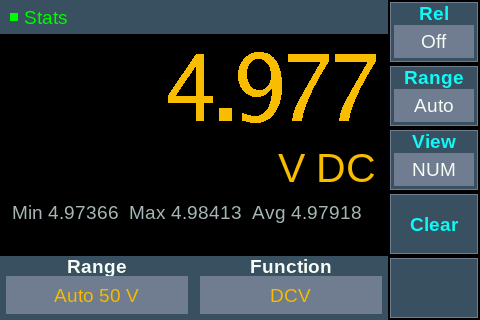 |
| **Auto-hold** | ✗ | ✓ | • probe, wait for the beep, lift, read<br>• RUN/STOP cycles run → hold → auto-hold<br>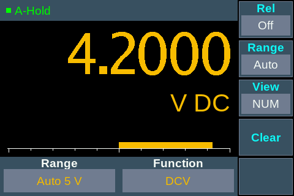 |
| **Beeper** | one tone | **adjustable** | • pitch and volume<br>• seven styles: classic, soft, chirp, drop, double, two-tone, warble<br>• attack, release and glide<br>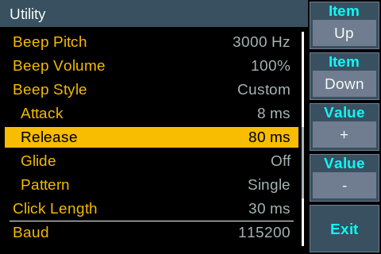 |
| **Diode beep** | fixed | **per junction** | • one short beep per junction<br>• at a threshold you choose<br>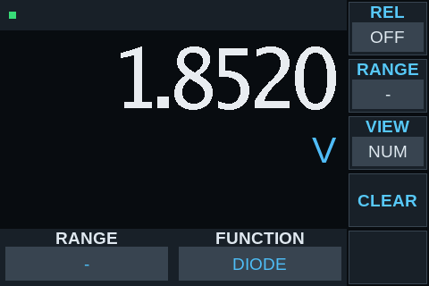 |
| **Backlight** | 31–100%, whines | **10–100%, silent** | • dims after a timeout you set<br>• PWM above hearing<br>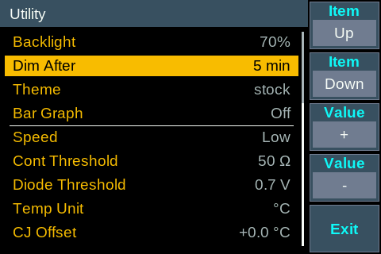 |
| **Look** | one theme | **five themes** | • anti-aliased font with real units (mA, kΩ, µF)<br>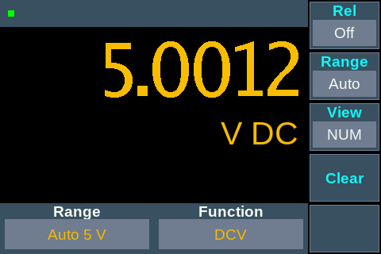 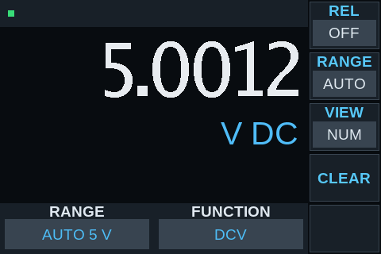 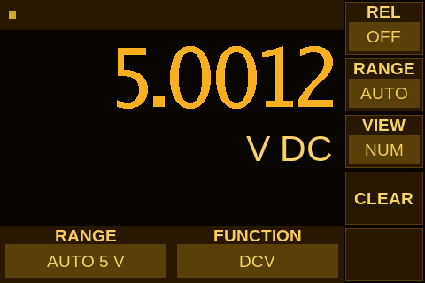 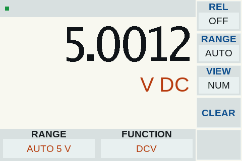 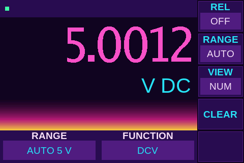 |
| **Temperature** | K, PT100 | **K, PT100, PT1000** | • PT100 lead-resistance correction<br>• cold-junction offset<br>• raw thermocouple mV beside the reading<br>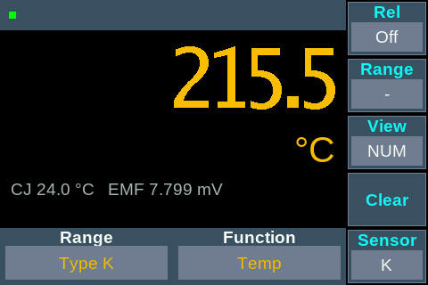 |
| **AC band warning** | ✗ | ✓ | • flags AC readings above the range's flat band (dual display)<br>• dual display: AC volts or current with frequency, or the AC and DC parts of one input<br>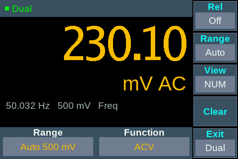 |
| **Power and energy** | ✗ | ✓ | • DC current with volts on the same leads: watts, plus Wh, mAh and elapsed time<br>• for charging or discharging a battery: net totals, signed<br>• DUAL → POWER on DC current; above 5 mA use the A jack (a relay on the 50/500 mA ranges)<br>• `MEAS:POW?`, `MEAS:ENER?`<br>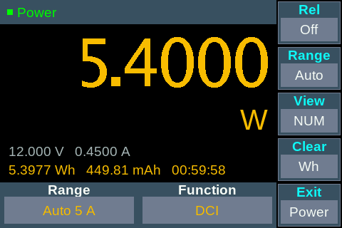 |
| **10 A input** | ✗ | ✓ | • alarm after 30 s above 7 A, then a rest countdown |
| **Remote control** | quirky | **conventional SCPI** | • continuity / diode swap fixed<br>• stock's reply formats kept<br>• commands for the log, the beeper and calibration |
| **Calibration** | service menus can wipe it | **read-only** | • the factory calibration is read, never written<br>• an optional user calibration on top, in its own storage<br>• a calibration page: every slot's gain and zero, user corrections, implausible slots flagged |
| **Updates** | OWON's tool | **USB serial** | • through OWON's bootloader, which is kept<br>• no opening the case |
| **Source** | closed | **open** | • everything here is in this repository |


Stock behaviour was measured on our V4.3.0 meter or reported on the
[EEVblog XDM1041 thread](https://www.eevblog.com/forum/testgear/owon-xdm1041-the-unknown-multimeter/)
([summary](docs/community-research.md)).

## How it was done

- **Stock's settings recovered by emulation.** No schematic and no
  working stock meter to probe: OWON's v2.1.2 firmware runs in an emulator
  and reports every front-end register and relay setting it would use for
  each range. Each one is then checked on the meter against reference parts.
- **The whole meter runs on a laptop.** A bit-level model of the front-end
  chip, the panel and the flash lets the real firmware be tested end to
  end, including power cuts at every flash write, before it goes on the
  meter.
- **Fast autoranging:** quick, low-resolution conversions find the range,
  then one full-resolution reading is taken there, jumping straight to
  the right range instead of stepping one at a time.
- **A 300 KB screen from 48 KB of RAM:** each frame is drawn in strips,
  and only the rows that changed are sent to the panel.
- **Volts and amps at once from one ADC:** power mode alternates the chip
  between two settings that need no relay to move, and corrects a leak
  found in the volts input.
- **Installed through OWON's own bootloader**, using the protocol the
  community worked out. The calibration area is never sent.

## Using it

- [Installing](docs/install.md) over USB serial.
- [User guide](docs/features.md): keys, screens, menus, recording.
- [Remote control](docs/scpi.md): `MEAS?`, `CONF:…`, `RANGE`, `RATE`,
  `CALC:…`, `LOG:…`.

## Safety

- **The factory calibration is irreplaceable.** OpenOWON only reads it,
  and nothing in this project erases that flash region.
- **Avoid stock's service menus and commands.** The hidden UTILITY-MATH /
  UTILITY-DUAL key sequences and `INT:START` can erase calibration
  ([list](docs/community-research.md)).

## For developers

```sh
make setup      # once: needs OWON's v2.1.2 image in firmware/ (firmware/README.md)
make check      # everything without hardware: unit tests, the simulator, the target builds
make sim        # run the whole meter on your computer; screenshots in build/
```

Start with the [developer guide](docs/developer-guide.md). How the stock
firmware was taken apart is in the reference docs ([index](docs/README.md));
bench results are in [`results/`](results/). What comes next:
[backlog](docs/backlog.md).

## Credits

OpenOWON stands on what other owners found and shared:

- **The EEVblog community**, in the thread
  [OWON XDM1041, the unknown multimeter](https://www.eevblog.com/forum/testgear/owon-xdm1041-the-unknown-multimeter/):
  five years of measurements, hardware revisions, stock's quirks and the
  service commands to avoid. Our [summary](docs/community-research.md)
  cites posts by number.
- **Petteri Aimonen**,
  [owon-xdm2041-info](https://github.com/PetteriAimonen/owon-xdm2041-info):
  OWON's bootloader protocol (the reason this installs over USB at all),
  the calibration record, and decoded HY3131 captures of the sibling
  XDM2041, which our recovered register table was checked against.
- **TheHWcave**, [OWON-XDM1041](https://github.com/TheHWcave/OWON-XDM1041):
  the SCPI command list, a logger, and OWON's updater with firmware 2.1.2,
  the image this project's reverse engineering started from.
- **Digilent**,
  [Arduino-DMMShield-Library](https://github.com/Digilent/Arduino-DMMShield-Library):
  an open HY3131 driver, our reference for the chip's register layout.
- **aziemer**, [Project Phoenix](https://github.com/aziemer/Project-Phoenix):
  open firmware for the XDM2041 family, proof that a replacement was
  possible.
- **Elektroarzt**'s ESP32 interface board (`owon-xdm-remote`, EEVblog #256),
  the model for our own Wi-Fi plans.

Tools: [Ghidra](https://ghidra-sre.org),
[Unicorn](https://www.unicorn-engine.org) (stock's front-end table was
recovered by running v2.1.2 in it), [PlatformIO](https://platformio.org),
[Unity](https://www.throwtheswitch.org/unity). Labels are set in
[Liberation Sans](https://github.com/liberationfonts/liberation-fonts)
(SIL Open Font License, `lib/ui/LICENSE-Liberation`).

## Licence

OpenOWON is free software under the [GNU General Public License v3.0](LICENSE):
use it, change it and share it; if you distribute it, changed or not,
share the source under the same licence. The label font keeps its own
licence (SIL OFL 1.1, `lib/ui/LICENSE-Liberation`).

## Not affiliated with OWON

An independent project. OWON's firmware, manual and datasheets are not
included; the READMEs in `firmware/`, `docs/manual/` and
`docs/datasheets/` say where to get them.
