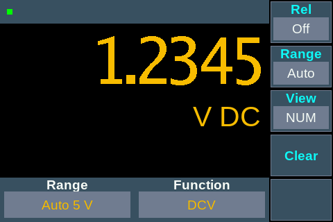
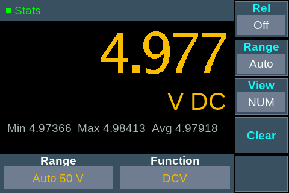
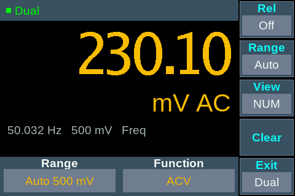
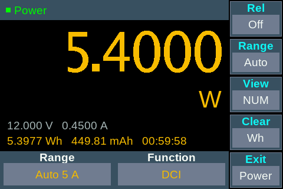
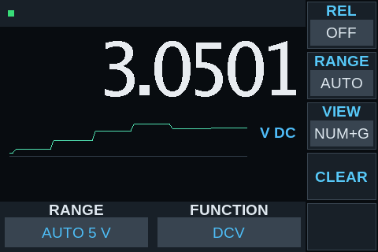
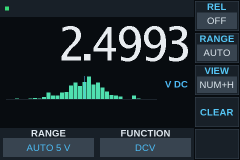
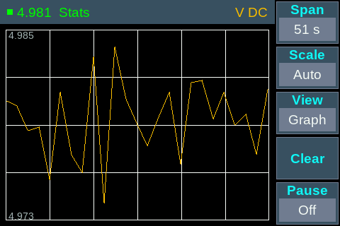
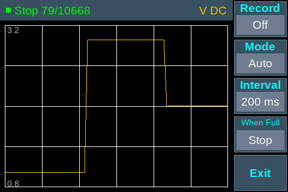
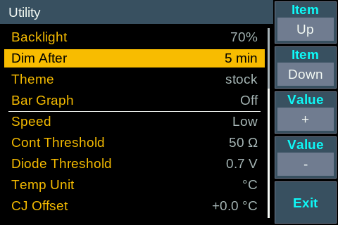

# Using OpenOWON

Key names are the front-panel labels from OWON's manual.

## The measurement screen



- **Middle:** the reading, in the meter's large digits, with its unit.
- **Top bar:** what's active: REC, RMT (remote control), HOLD, REL, STATS,
  dBm or dB.
- **Footer:** the range (AUTO when autoranging) and the function.
- **Right-hand column:** what the five softkeys beside the screen (F1–F5, top to bottom) do on this screen.
- **Line under the reading:** min/max/average, dBm, duty cycle,
  the cold-junction temperature with the thermocouple's raw EMF in mV (to
  check a probe against a reference), or the REL offset, depending on
  what's active.

### Choosing a function

| Key | Selects | Press again |
| --- | --- | --- |
| V | DC voltage | AC ↔ DC |
| I | DC current | AC ↔ DC. F5 switches between the **mA** and **A** inputs |
| OHM | resistance | continuity, then diode, then back |
| CAP | capacitance | |
| FREQ | frequency | frequency ↔ period |
| TEMP | thermocouple (type K) | type K → PT100 → PT1000 (F5 SENSOR does the same). |

### Range

- **Autoranging is on by default.** It reaches the right range in at most
  two steps, and from 50 mV to 1000 V in either direction.
- **The reading appears as soon as the range is right**, not on the next
  display update.
- **Noise near a range boundary doesn't make it flip back and forth.**
- **Current has two inputs,** the mA jack (500 µA – 500 mA) and the A jack
  (5 A, 10 A). Ranging stays on the selected one, and too much current for
  the mA input shows overload. Move the lead and press F5. In DC and AC
  current, **leave the V jack empty**: a voltage on it above ~2 V adds to
  the reading.
- **UP / DOWN** choose a range by hand, which switches autoranging off.
- **LEFT** *(provisional)* or **F2** turn autoranging back on.

### Softkeys

| Key | Does |
| --- | --- |
| F1 | **REL**: the current reading becomes zero. Works with statistics and dB |
| F2 | auto ↔ manual range |
| F3 | **VIEW**: number → number + mini trend → number + mini histogram → graph → histogram → number |
| F4 | clear statistics and the graph |
| F5 | depends on the function: mA/A input (current), frequency/period, thermocouple/PT100, or the dBm reference. In dual display: **EXIT** |

Every key press clicks, as on stock (turn the beeper off in the Utility
menu to silence it). The colour theme is in the Utility menu.

### Other keys

| Key | Does |
| --- | --- |
| RUN/STOP | cycles **Run → Hold → Auto-hold → Run** (the top bar shows HOLD or A-HOLD). Under remote control: return to the front panel |
| MATH | off → min/max/average → dBm (voltage only) → off |
| UTILITY | the Utility menu |
| RECORD | the record screen |
| DUAL | dual display (below) |



### Capacitance on this meter (provisional)

On the real front end, capacitance has all seven ranges: 50 nF, 500 nF,
5 µF, 50 µF and 500 µF on the chip's counters, and 5 mF and 50 mF by
charge slope: the meter rests the capacitor, charges it at a constant
current for 2-3 s, reads it every 246 ms and fits a line to the rise. A
reading takes about 1.3 s on the counter ranges (longer for large values:
one charge cycle of a 260 µF part is ~3 s), 3 s on 5 mF and 5.5 s on
50 mF. Autoranging goes straight to the range a reading says. Large
capacitors are still slow to arrive, because the hardware is: on the
500 µF range one charge cycle takes ~21 ms per µF, and a part too big for
a range gives nothing until a cycle ends. On our meter, from selecting CAP: about
3-4 s for nF parts (simulator), 12 s for 100 µF and 15 s for 1000 µF
(stock-like ranging took 14.5 s and 22 s); once on the right range, a new
reading every ~2 s (100 µF) or ~3 s (1000 µF). UP/DOWN to the right range
is quicker if you know it. On our meter a
1000 µF electrolytic reads 1.085 mF, steady to ±0.3% over 17 readings, and
an 18 mF one 17.64 mF, ±0.45% over 28 readings (drifting up 1% over the
first minute and a half, as electrolytics do under repeated charging). Checked against
LCR-measured parts (not precision ones): open leads read about 0, film
parts from 48 nF to 10 µF read 2-3.5% low, electrolytics up to 264 µF agree
within their own uncertainty. Stock's factory calibration is used as is;
if you have better references, user calibration (`CAL:USER`,
`docs/user-calibration.md`) corrects a range (`docs/afe-table.md`).

### Bar graph

Turn on **BAR GRAPH** in the Utility menu for an analog-style bar under the
reading: zero to full scale of the range, with ticks every 10%. For DC
volts and current (and with REL on) zero is in the middle, so negative
readings go left. It turns to the warning colour past full scale.
Frequency and temperature have no full scale, so no bar.

### The 10 A input's duty limit

The 10 A input is rated for 30 seconds above 7 A, then 30 seconds off.
After 30 s above 7 A the line under the reading says **OVER 7 A FOR …:
REMOVE THE LOAD** and an alarm beeps every second (at the beeper's pitch,
a little higher). When the current drops it counts down **10 A INPUT: REST
… s**. Nothing happens below 7 A or on the mA input.

### Auto-hold

Press **RUN/STOP** twice (Run → Hold → Auto-hold; the top bar shows A-HOLD). When a
reading holds steady for about a second (within 0.1%) and is a real
measurement (not open leads, above 2% of the range), the display freezes
on it and the meter beeps once. Take the probes away and the reading stays,
so you can probe a point, look down and read it. Probe the next point and
the display moves to the new reading with another beep.

Only the display holds: the graph, statistics, recording and `MEAS?` over
the serial port keep reading live. Continuity is never held. RUN/STOP is
still the manual hold: one press holds, a second switches to auto-hold, a third returns to running.

## Dual display

Two readings of one signal: AC volts or current with its frequency, as
stock (OWON's manual, p. 27), and **the AC and DC parts of the same input**
(ours, B23): DC volts with AC volts, AC volts with DC volts, and the same
for current, for instance the ripple on a supply rail beside its DC level.



| Key | Does |
| --- | --- |
| DUAL (in volts or current) | shows the choice of second reading on the softkeys: F1 **FREQ** (AC only), F2 **DC** or **AC** (the other half of the same input) |
| DUAL (while on) | swaps the main and second readings |
| F5 **EXIT** | turns dual display off |

**Rules:**
- **Measuring:** the meter alternates between the two measurements, about
  five main readings to one second reading. With AC and DC together the
  second reading uses the matching range on the other side (5 V DC with
  5 V AC) and follows the main one's range; the relays may click as it
  alternates.
- **Other functions:** DUAL does nothing.
- **Math:** turning dual on switches off REL, statistics and dBm. Turning any
  of those on, or changing function, switches dual off.
- **Recording:** saves the main AC reading.
- **Serial:** `MEAS?` then returns both readings, `MEAS2?` the frequency,
  and `FUNC2?` returns `FREQ`, as stock does (`scpi.md`).

DC current with DC volts (and so watts) is the **POWER** view below.

Above about 4 kHz the AC front end starts to read low (on this meter
about −1% at 3 kHz and −12% at 10 kHz). The **5 V range** falls off much
sooner: about −3% at 1 kHz and −12% at 3 kHz (not understood yet). When
dual display knows the frequency is above the range's limit, the line
under the reading adds **> 4 kHz: AC reads low** (or **> 500 Hz** on the
5 V range).

### AC volts, current and frequency on this meter

AC volts (all five ranges, 500 mV to 750 V) and frequency now come from
the real front end. Checked at 60 Hz with a transformer and resistor
dividers: every range agrees with its neighbour within 0.25%, and the
50, 500 and 750 V ranges with the transformer within 0.2%, on stock's
factory calibration. Frequency read 60 Hz-10 kHz to about 0.01% against
a signal generator.

AC current, all six ranges on both jacks, is on the real front end too,
on stock's factory calibration: 500 µA-50 mA within 0.5% of the current
through a measured resistor (100 Hz and 1 kHz), 500 mA within 0.2% of the
50 mA range, and the A jack's 5 A and 10 A within 0.5% at 1.8 A (60 Hz).

## Power and energy

On DC current, **DUAL → F3 POWER** measures the voltage too, in turn with
the current on the same connection, and shows:

- **watts** as the big reading (V × I, signed);
- the **volts and current** underneath;
- **energy (Wh), charge (Ah) and the time** they cover, added up from
  every reading since you turned power on or pressed **F4 CLEAR Wh**.

Wire it low side: supply or charger − to **COM**, the load (or battery)
between supply + and the **mA** or **A** jack, and the **VΩ** lead to the
supply +.

**Above 5 mA, use the A jack** (F5 on DC current; the 5 A range resolves
0.1 mA). On the mA jack's 50 mA and 500 mA ranges a relay inside the meter
would have to switch for every volts reading, and switching it breaks the
current path for the moment the volts are read. So on those two ranges
POWER only reads volts up to 500 mV, and shows the volts over range above
that, rather than interrupting your circuit. The 500 µA and 5 mA ranges
and the A jack read every voltage. The volts then include the meter's shunt drop. Current the other
way (a battery discharging, or swapped leads) gives negative watts, and
the totals count down: they are net energy and charge.

**The VΩ lead and the current:** on this meter a voltage above about
2.15 V on the VΩ jack adds to the current reading (its input protection
upsets the measurement; nothing extra flows in your circuit). POWER keeps
that lead on the supply, so on the A jack it subtracts the measured
amount, about 1.09 mA per volt above 2.15 V; checked at 5 V to within
0.01 mA. Measured up to 10 V; above that it is extrapolated. In plain DC
or AC current, **leave the VΩ jack empty**.

The volts range itself; the current ranges as usual. Volts and current
each update about every 1.5 s at SPEED low, faster at mid and high. The
graph (VIEW) follows the watts. **F5 EXIT** ends it; changing function
ends it too, and the totals start again next time.

**Recording** in power mode logs the watts: the session shows W when you
browse it, `LOG:FUNC?` answers `"POW"` and `LOG:DATA?` returns watts. The
15 ms interval isn't offered (volts and current alternate); 200 ms and up
are. Turning power on or off ends a recording, as changing function does.

Remote: `FUNC2 POW`, then `MEAS:POW?`, `MEAS:ENER?` (Wh), `MEAS:CHAR?`
(Ah), `MEAS:ENER:TIME?` (s), `CALC:ENER:CLE` (`scpi.md`).

**Checked on this meter** (2026-11-16, a 5 V supply into a resistor): on
the 5 mA range, volts agree with the supply within 0.001% and the current
holds within 0.002% across each volts reading; watts, Wh and Ah agree
with V × I and the elapsed time. On the 500 mA range a scope across the
load showed the current stopping at each relay click, which is why those
ranges are limited as above. Current accuracy is the DC current
function's (see above); no separate accuracy figure is claimed.



## Mini trend and histogram under the reading

VIEW (F3) once keeps the big reading and draws the **trend** of recent
readings under it, in the space the unit used (the unit moves to the
right, smaller). VIEW again shows their **histogram** there instead, with
the mean marked. Both use the graph's readings and span; CLEAR (F4) starts
them afresh.




## The trend graph

VIEW (F3) a third time shows a full-screen graph of recent readings. The
live reading stays in the top bar.



| Key | Does |
| --- | --- |
| F1 | **span**: 51 s, 4 min or 26 min across the screen |
| F2 | **scale**: fit the trace, or the range's full scale (e.g. ±5 V) |
| F3 | the histogram (below) |
| F4 | clear |
| F5 | pause the graph; the reading carries on |

### Histogram

Press VIEW (F3) again on the graph screen for a **histogram** of the same
readings: 32 bars across their spread, the mean marked, and MEAN, SD
(standard deviation) and N at the top. Useful for judging noise, for
instance when choosing the speed setting. SPAN, PAUSE and CLEAR work as on
the graph. VIEW once more returns to the reading.

## Recording

RECORD opens the record screen.



| Key | Does |
| --- | --- |
| F1 | start / stop. Starting a new recording replaces the old one |
| F2 | **AUTO**: a reading every interval. **MANUAL**: one per F4 press |
| F3 | interval: **15 ms**, 200 ms, 1, 2, 5, 10, 30 s, 1 or 5 min. At 15 ms (DC volts, DC current and ohms; B24) the meter converts every 15 ms and records every reading, as stock's internal recorder does: 10,668 readings is about 2.7 minutes, for catching transients. At 200 ms it records every new reading: about 4 a second for DC volts and ohms, faster for continuity and diode |
| F4 | manual mode: take a reading. Auto mode, before starting: **WHEN FULL**, STOP (the recording ends at 10,668 readings) or ROLL (it carries on, overwriting the oldest readings, so it always holds the latest 10,668) |
| F5 (**EXIT**) or RECORD | back to the measurement. Recording carries on, with REC in the top bar |
| ▲ / ▼ | browse: a cursor on the plot, moved forward / back. The top line shows that reading exactly (the plot shows averages), its number, and when it was taken: the clock time if the meter's clock is set (`#13: 3  14:05:32`), else the time since the start (`#13: 3  +0:00:12`) |
| RANGE | browse in steps of 1 or 16 plot points |

**Capacity and behaviour:**
- **Up to 10,668 readings**, stored as they're taken. With WHEN FULL set to
  ROLL the recording never fills: the top line shows ROLL, and the log holds
  the newest 10,668 readings (at 200 ms, the last 35 minutes; at 1 min, the
  last 7 days).
- **Power cuts lose nothing already written.** The recording is still there
  at the next power-on.
- **One quantity per recording.** Changing function or unit ends the
  recording, so it stays in one unit.
- **Overloads are logged** as overloads.
- **Timestamps** (B33): with the meter's clock set, each recording keeps its
  start time; `LOG:TIME?` returns it (`2026-11-15T14:05:20`), and every
  reading's time follows from the interval.

**The clock.** The meter has a real-time clock with a backup cell, so it
keeps time with the power off. Set it over the serial port:
`SYST:DATE 2026,11,15` and `SYST:TIME 14,05,00` (24-hour); Utility → CLOCK
shows it. No time zones: it keeps whatever time you set.

**Downloading:** `LOG:DATA?` over the serial port returns the readings
(see Remote control below).

## The Utility menu

UTILITY opens it.
- **Pick a row:** UP/DOWN (or F1/F2).
- **Change it:** F3/F4 (the RANGE key also steps a value down).
- **Close:** UTILITY, F5 (**EXIT**) or RUN/STOP.

Changes apply at once and are remembered. The rows come in groups, with a
line between: display, measuring, sound, system.



| Setting | Choices |
| --- | --- |
| Backlight | 10–100% |
| Dim after | never, 1, 5, 15 or 30 min of no key presses; the first key press only wakes the screen |
| Theme | stock, dark, amber, paper, synthwave (neon on violet, a sunset glow above the footer) |
| Bar graph | on / off (default off): see Bar graph above |
| Speed | low / mid / high: a reading every ~246 / 123 / 61 ms for DC volts, DC current, ohms and temperature (low is the quietest; even low is faster than stock's fastest). AC, continuity, diode, capacitance and frequency keep their own rates |
| Continuity threshold | 5 – 1000 Ω (default 50 Ω) |
| Diode threshold | 0.1 – 3.0 V in 0.1 V steps (default 0.7 V): the diode beep sounds once when a junction drops less than this. Raise it to about 2–3 V to beep on LEDs |
| Temperature unit | °C, °F, K |
| CJ offset | −5.0 – +5.0 °C in 0.1 °C steps (default 0): added to the cold-junction (terminal) temperature the meter measures for thermocouples. Set it if the CJ reading under a type-K measurement differs from a thermometer at the input terminals |
| PT100 leads | 0.00 – 5.00 Ω in 0.05 Ω steps: your test leads' resistance, subtracted from PT100 readings (a 2-wire PT100 reads about 2.6 °C high per ohm of lead). Or set it exactly over SCPI: select PT100, short the probe's two wires together at the sensor end, send `TEMP:RTD:LEAD NULL`. The line under a PT100 reading shows the raw resistance and the correction in use |
| dBm reference | 50 – 8000 Ω (default 600 Ω) |
| Beeper | on / off: the key click; continuity sounds while the leads are below the threshold; diode gives one short beep when a junction drops between 0 V and the diode threshold, and again only after the leads open |
| Beep pitch | 1000 – 4000 Hz in 500 Hz steps (default 3000 Hz, close to stock's 3.04 kHz). Plays a test beep as you change it. The key click sounds a little higher, so you can tell a key from a result |
| Beep volume | 10 – 100% (default 100%). Plays a test beep as you change it |
| Beep style | a preset for the settings below: **CLASSIC** (plain, as stock), **SOFT** (fades in and out), **CHIRP** (glides up), **DROP** (glides down), **DOUBLE** (two short beeps; continuity pulses), **TWO-TONE** (high then low; continuity alternates), **WARBLE** (trills between two pitches). **CUSTOM** appears when you change the settings yourself. The key click is always a plain single beep |
| Attack | 0 – 50 ms: how quickly a beep swells to full volume (0 = instant, as stock) |
| Release | 0 – 300 ms: how long a beep fades after it ends. A short beep never fades for longer than it lasted, so clicks stay crisp; continuity fades by the full amount when the leads part |
| Glide | −50 – +50%: each beep slides up (or down) in pitch by this much (continuity stays steady) |
| Pattern | SINGLE, DOUBLE, TWO-TONE, WARBLE (as the styles of those names) |
| Click length | 10 – 80 ms: the key click (default 30 ms) |
| Baud | 9600 – 115200 |
| Load defaults | press RIGHT twice |
| Version, clock, serial number | information only |
| Battery | the cell's voltage and charge (%), also shown as the gauge at the top right of every screen, which turns red at 10%. The % is from a typical 18650 curve, so take it as a guide; while charging it reads high |
| Calibration | its status; **RIGHT opens the calibration page**: every factory slot by function and range, with its gain (as % from 1.000), its zero, any user correction on it (U), and BAD if the gain is implausible. ▲/▼ scroll, LEFT or EXIT go back |

## What the meter remembers

At power-on, the meter comes back as you left it:
- function, and the range of every function;
- auto/manual ranging;
- speed;
- every Utility menu setting;
- graph span;
- recording mode and interval.

Settings are saved a few seconds after the last change, in storage that a
power cut mid-save cannot corrupt.

## Your own calibration

The meter always uses its factory calibration, which this firmware never
changes. On top of it you can add your own correction for any range, if
you have a better reference. It's done over the serial port
([`docs/user-calibration.md`](user-calibration.md)):

1. Select the range by hand, e.g. `CONF:VOLT:DC 5` (the 5 V range).
2. Short the leads, send `CAL:USER:ZERO`, and wait for `CAL:USER:STAT?` to
   say `DONE` (it averages 16 readings).
3. Apply a reference near full scale, send `CAL:USER:GAIN 4.0400` (the
   reference's value), and wait again.

The top bar shows **UCAL** on a range with your correction, and the Utility
menu's CALIBRATION row says FACTORY + USER n. Corrections over 2% (gain) or
1% of the range (zero) are refused as a wrong range or reference.
`CAL:USER:CLEAR` (or `CLEAR ALL`) returns to the factory calibration.
`CAL:FACT:LIST?` lists the factory slots as the calibration page shows them.

## Remote control

The serial port (115200 baud, 8N1 by default) speaks SCPI. A few examples:

```
*IDN?                     OWON,XDM1241,<serial>,<version>
CONF:VOLT:DC 5            DC volts, 5 V range
MEAS?                     1.234500E+00
CALC:FUNC AVER            statistics on
LOG:INT 1                 record every second
LOG:STAR                  start recording
LOG:DATA? 0,100           the first 100 readings
```

- **Compatibility:** replies use stock's formats, so existing tools keep
  working, including OWON's own log download (`int:record?`), which reads
  our much larger log.
- **Front panel locking:** `SYST:REM` locks the front panel; RUN/STOP (or
  `SYST:LOC`) unlocks it.
- **Full command list:** [`scpi.md`](scpi.md).

## Calibration

- **Factory calibration:** the firmware uses the meter's own factory
  calibration, read from flash. The Utility menu shows **FACTORY** when it
  loaded correctly.
- **If the record looks damaged:** it reads **UNITY n BAD**, uses unity
  gains, and leaves the record untouched.
- **Never written:** the firmware never writes the calibration.
