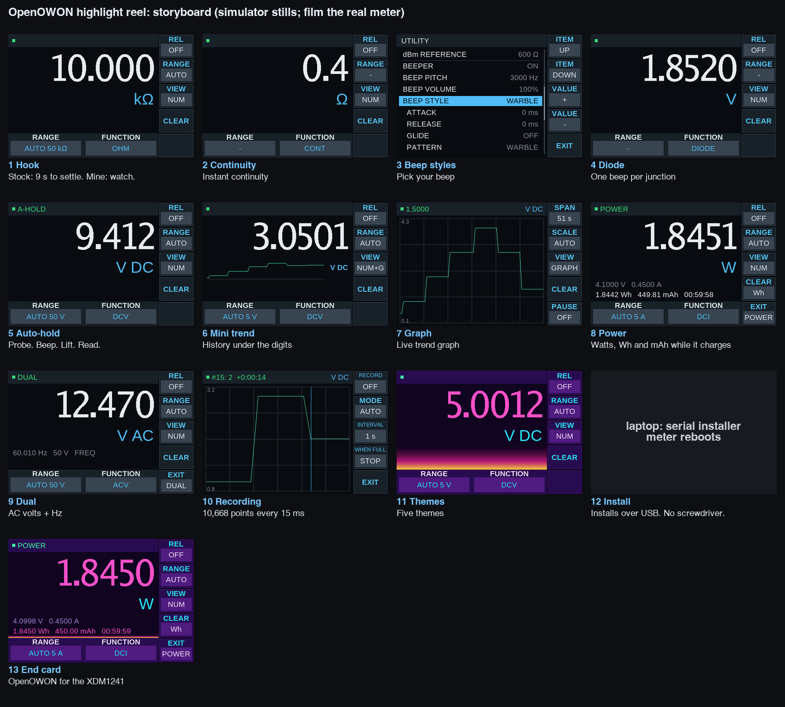
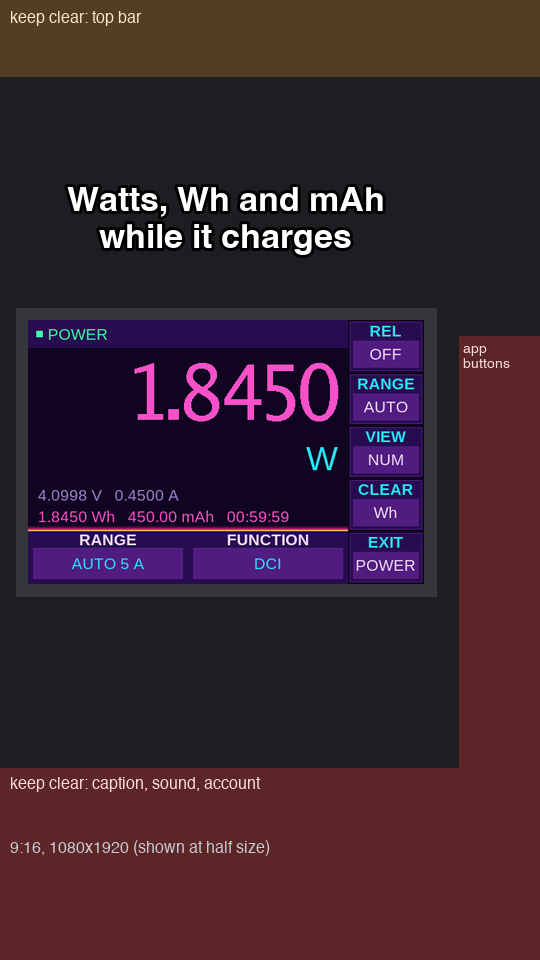

# Highlight reel: the video plan

A vertical, TikTok-style reel of OpenOWON's best features, filmed on the
real meter. Each beat below has a simulator still to film against
([storyboard](video/storyboard.png), from `scenarios/reel.sim`: regenerate
with `make storyboard`), the meter setup, and the claim its caption makes
with where that claim was proven. **Every caption is a number measured on
our meter**, so the video can be checked against the repo.

## Format

- **9:16, 1080 × 1920, 45–55 s**, about 13 beats of 3–5 s.
- **Captions burned in** (most people watch muted), white, bold, black
  outline, above the meter's screen.
- **Keep clear** ([frame guide](video/frame-guide.png)): the bottom 20%
  (caption, sound and account), the right 15% from a third of the way down
  (the app's buttons) and the top 8%. Frame the meter so its screen sits
  in the upper middle, left of the buttons.
- **Sound:** the beeps are a feature: record them clean, no music under
  beats 2–4; music under the rest.
- **No stock footage:** stock is gone from our meter, so stock's numbers are
  caption text ("Stock: 9 s"), sourced below.

## The beats

| # | s | Film | Meter setup | Caption | The claim, and where it's proven |
| --- | --- | --- | --- | --- | --- |
| 1 | 0–4 | **Hook.** Probes on a 10 kΩ resistor: lift, touch again; the reading is back at once. 240 fps if you can | OHM, autorange, dark theme | "Stock: 9 s to settle. Mine: watch." | ohms: lift ~0.3 s, touch 0.3–0.8 s; stock 7–9 s across the ranges, ~3.5 s touched, measured on our V4.3.0 (`test-plan.md` T-RANGE, `results/ohm-step-20261114.md`) |
| 2 | 4–7 | Tap the probe tips together quickly; every tap beeps | CONT | "Instant continuity" | beeps per sample, not per display update (`features.md`) |
| 3 | 7–12 | The same taps while stepping BEEP STYLE: DROP, DOUBLE, TWO-TONE, WARBLE | UTILITY → BEEP STYLE | "Pick your beep" | seven styles, pitch, volume, envelope (`features.md`) |
| 4 | 12–15 | An LED on the probes lights, one short beep | DIODE | "One beep per junction" | `features.md` |
| 5 | 15–19 | Probe a 9 V battery, beep, lift: the reading stays | RUN/STOP twice (auto-hold) | "Probe. Beep. Lift. Read." | `features.md` |
| 6 | 19–23 | Turn a pot slowly: the trend draws under the big digits | DCV, VIEW → NUM+G | "History under the digits" | |
| 7 | 23–27 | The full trend graph, then the histogram | VIEW → GRAPH → HISTO | "Live trend graph" | |
| 8 | 27–32 | **A Li-ion cell charging**: watts big, Wh / mAh / time ticking | DC current on the **A** jack (F5), DUAL → F3 POWER; volts lead on cell + | "Watts, Wh and mAh while it charges" | on our meter 2026-11-16: 0.4186 W at 5 V, current within 0.01 mA of plain DC current (`test-plan.md`, evening). **Use the A jack** |
| 9 | 32–35 | The transformer: AC volts with its frequency | ACV, DUAL → F1 FREQ | "AC volts + Hz" | AC volts within 0.25% between ranges at 60 Hz, frequency to ~0.01% (`results/acv-freq-20261113.md`) |
| 10 | 35–39 | RECORD on, the trace fills; then browse with the cursor | DCV, RECORD: interval **15 ms**, F1 | "10,668 points, every 15 ms" | 574 readings in ~10 s at 15 ms (`test-plan.md`, 2026-11-16); stock 1,000 points |
| 11 | 39–43 | **Themes on the beat**: stock, dark, amber, paper, synthwave, a jump cut each | UTILITY → THEME | "Five themes" | |
| 12 | 43–47 | Laptop: the installer's progress, the meter reboots into OpenOWON | `scripts/serial-update.py` | "Installs over USB. No screwdriver." | `install.md` |
| 13 | 47–52 | **End card**: the synthwave power screen, held | beat 8 in synthwave | "OpenOWON, open firmware for the XDM1241" | |

Spares if a beat doesn't land: SPEED high, 16 readings a second
(16.2 / s measured, stock 1–3 / s); the bar graph; statistics with REL;
capacitance up to 50 mF (18 mF read 17.64 mF).

## What to have on the bench

10 kΩ resistor · an LED · 9 V battery · a pot across a supply or battery
(beats 6, 7, 10) · the 9 VAC transformer · a Li-ion cell on a charger or
supply (beat 8: the charge current through the A jack, COM to cell −, the
volts lead on cell +) · the laptop on the meter's USB.

## Filming

- Phone on a stand above the meter, tilted ~15° against glare.
- Lock focus and exposure on the screen; shutter 1/50 or 1/60 s so the
  panel doesn't band.
- Dark theme for every beat but 11 and 13: best contrast on camera.
- Fingers off the screen; a plain dark mat under the meter.
- Beats 1 and 2 at **240 fps**: counting frames also measures settle time
  and beep latency, worth having before quoting them.

## Before posting

- **No link in the video or bio until the public repo is up**: a squashed
  export without `backups/` (OWON's code and our meter's serial), GPL-3.0.
  Read the README's install warning again before it goes out.
- Captions must stay true: if a beat is re-shot with a different part,
  re-check its number against the column above.
